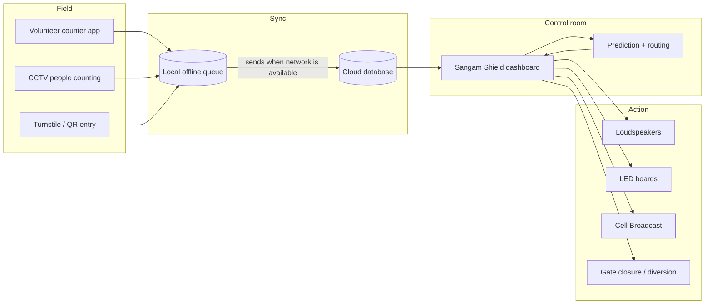
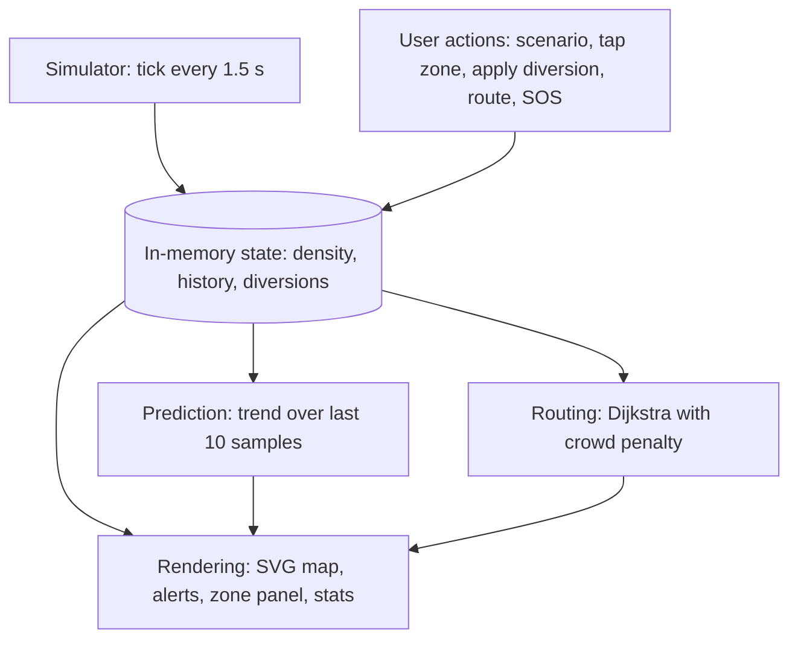
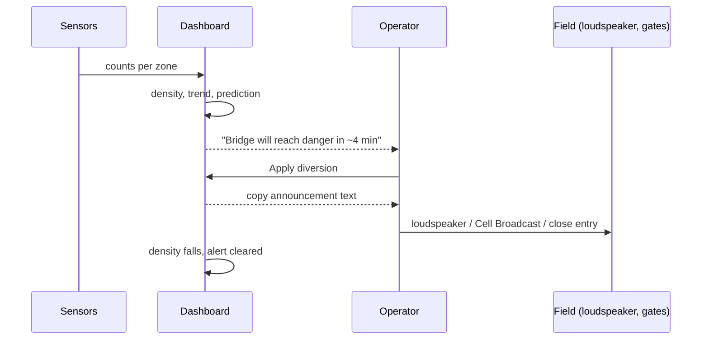

# Technical Design Document: Sangam Shield

## 1. Goal and scope
Give a control room a live picture of crowd density across a gathering, warn **before** a zone becomes dangerous, and help staff act (divert, announce, route, dispatch help).

- **Phase 1 (this repo):** single-page prototype with simulated data. No backend.
- **Phase 2 (planned):** real counts from volunteers and CCTV, offline-first sync, real GIS map.

## 2. Architecture

### 2.1 Target (real-world) architecture


### 2.2 Phase 1 prototype architecture

The prototype is one HTML file with no external libraries (only Google Fonts for typography).

## 3. Data model
| Entity | Fields |
|--------|--------|
| Zone | `id`, `name` (en, hi), `x`, `y` (map position), `area_m2`, `base_density` |
| Path | pair of zone ids; length from map distance (1 map unit = 1.6 m) |
| Reading (Phase 2) | `zone_id`, `timestamp`, `count`, `source` |
| Alert | `kind` (danger, predicted, diversion, sos), `zone`, `time`, details |

See `data/sample_data.json`.

## 4. Core logic

### 4.1 Density and capacity
```
density (people/m²) = count / area_m2
people on site      = Σ (density × area_m2)
safe capacity       = area_m2 × 4
```
Status: **safe** below 2.5, **busy** 2.5 to 4, **danger** from 4.0 people/m².

### 4.2 Simulation (Phase 1 only)
Every tick (1.5 s), each zone moves towards a target:
```
target = base × scenario_multiplier + added_crowd + surge − diversion + 0.2 × (neighbours diverted)
density += (target − density) × 0.25 + small random noise      (clamped 0.2 to 6.5)
```
Scenario multipliers: normal 0.75, peak 1.2. Surge adds 2.8 at Bridge. Diversion subtracts 3.0 at that zone.

### 4.3 Prediction
Least-squares slope over the last 10 readings. Each tick is treated as 30 s of event time.
```
if slope > 0.03 per tick and density < 4:
    minutes_to_danger = (4 − density) / (slope × 2)
    raise "predicted" alert if ≤ 10 minutes
```
This is a trend line, not a trained model. Phase 2 can replace it with a proper forecast.

### 4.4 Safe routing
Dijkstra over the zone graph. Edge cost:
```
cost = distance × (1 + max(0, avg_density − 2)² × 0.7)
+2000 if the next zone is at 5+ people/m² (unless it is the destination)
```
Walking time uses 1.2 m/s, slowed by up to 70% as density rises. The shortest-by-distance route is also computed so the UI can say when it is being avoided.

### 4.5 Diversion
Applying a diversion lowers the zone's target and slightly raises neighbours. It shows the **trade-off** of a decision, not only the problem.

## 5. Sequence: alert to action


## 6. Working with weak networks (Phase 2 design)
- Send **numbers only** (a few bytes per reading), never video.
- **Offline-first** counters: store locally, sync when a connection returns. Weak networks delay data; they do not lose it.
- Backup channels for counters (SMS, radio). Control room on a dedicated link.
- Alerts to pilgrims through loudspeakers, LED boards and Cell Broadcast, not through their data connection.

## 7. Privacy and safety
- Only **counts**, no faces or personal identity.
- Decision support only. Police and trained crowd managers decide.
- False alerts are possible; thresholds must be calibrated on small real events before any large deployment.
- Real deployment needs administration permission.

## 8. Limitations
Simulated data; illustrative map and areas; simple trend prediction; two languages; no authentication or multi-user roles yet.

## 9. Roadmap
1. Pilot at a local mela: 4 to 5 volunteers, 3 to 4 counting points, live dashboard.
2. Offline-first counter app with cloud sync.
3. Real GIS base map and surveyed zone areas.
4. Calibrated prediction using pilot data.
5. Roles (control room, field supervisor), audit log, more languages (Marathi, Odia).
6. Reuse for Puri Rath Yatra and cyclone shelter management.

## 10. Testing
Automated smoke tests (`npm test`) and manual cases in `tests/TEST_CASES.md`.
